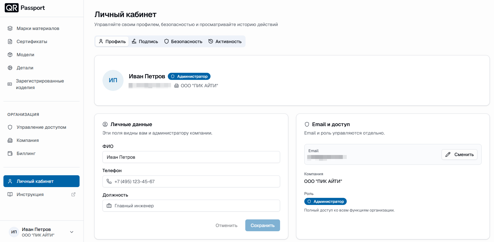
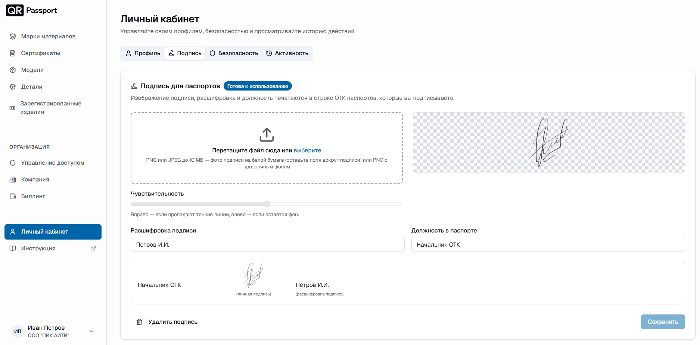
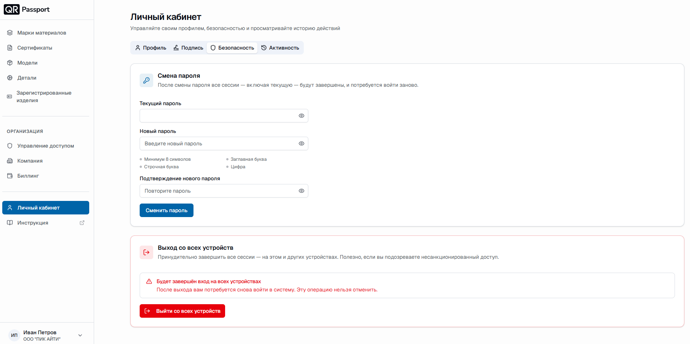
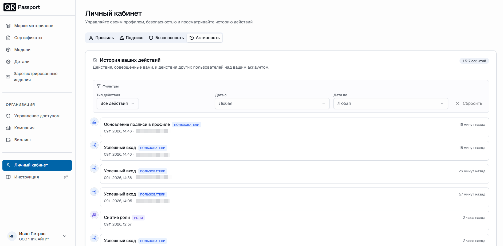

  <a href="/ru/">Главная</a> / Личный кабинет

# Личный кабинет

В личном кабинете можете управлять своим профилем, подписью для паспортов, безопасностью аккаунта и просматривать историю действий. Раздел состоит из четырех вкладок: **«Профиль»**, **«Подпись»**, **«Безопасность»** и **«Активность»**.

## Вкладка «Профиль»

В верхней части карточки отображаются ваши имя, роль и компания.

### Личные данные

Здесь можно заполнить или изменить ФИО, телефон и должность. Эти поля видны вам и администратору компании. После ввода нажмите **«Сохранить»**; кнопка **«Отменить»** сбрасывает несохраненные изменения.

### Email и доступ

Email и роль управляются отдельно:

- **Email** – нажмите **«Сменить»**, чтобы обновить адрес;
- **Компания** – организация, к которой вы подключены;
- **Роль** – ваша текущая роль;
- **Дополнительные разрешения** – индивидуальные разрешения, которые входят в вашу роль.

## Вкладка «Подпись»

Подпись используется при подписании паспортов в роли ОТК: изображение подписи, расшифровка и должность печатаются в строке ОТК каждого паспорта, который вы подписываете. Когда изображение загружено и поля заполнены, в заголовке карточки отображается статус **«Готово к использованию»**.

### Загрузка изображения подписи

Перетащите файл в область загрузки или нажмите **«выберите»**, чтобы загрузить изображение с устройства. Поддерживаются форматы PNG и JPEG размером до 10 МБ:

- фото подписи от руки на белой бумаге – оставьте поля вокруг подписи, чтобы система корректно выделила контур;
- PNG с прозрачным фоном – готовое изображение подписи без фона.

Справа от области загрузки показывается превью загруженного изображения на шахматном фоне (зоны прозрачности).

### Чувствительность

Ползунок **«Чувствительность»** помогает отделить подпись от фона при обработке фотографии:

- вправо – если в подписи пропадают тонкие линии;
- влево – если на изображении остаётся фон.

Перемещайте ползунок до тех пор, пока в превью не останется только подпись без посторонних элементов.

### Расшифровка и должность

Заполните два поля, значения которых попадут в строку ОТК паспорта:

- **Расшифровка подписи** – фамилия и инициалы, например «Петров И.И.»;
- **Должность в паспорте** – должность, указанная при подписании, например «Начальник ОТК».

### Предпросмотр строки ОТК

В нижней части карточки показан пример того, как подпись будет выглядеть в паспорте, так вы можете проверить результат до подписания документов.



Строка ОТК формируется из сохранённых изображения, расшифровки и должности. Перед подписанием сверяйте предпросмотр, чтобы данные в паспорте были корректными.



## Вкладка «Безопасность»

### Смена пароля

1. Введите **текущий пароль**.
2. Введите **новый пароль**. Требования: минимум 8 символов, заглавная и строчная буквы, хотя бы одна цифра.
3. Повторите новый пароль в поле **подтверждения**.
4. Нажмите **«Сменить пароль»**.

После смены пароля все сессии, включая текущую, завершатся, и потребуется войти заново.

### Выход со всех устройств

Кнопка **«Выйти со всех устройств»** принудительно завершает все сессии на этом и других устройствах. Это полезно, если вы подозреваете несанкционированный доступ к аккаунту. Операция необратима: после выхода нужно войти в систему снова.

## Вкладка «Активность»

Здесь отображается история ваших действий в системе. Для каждого события указываются тип, дата и время.

Список можно фильтровать по **типу действия** и **периоду** (дата с / дата по); кнопка **«Сбросить»** очищает фильтры.