

  <a href="/ru/">Главная</a> / Зарегистрированные изделия

# Зарегистрированные изделия

Раздел «Зарегистрированные изделия» хранит все зарегистрированные изделия по всем моделям компании. Зарегистрированное изделие – полноценный объект учета: оно получает серийный номер, собственный QR-код и паспорт.

## Внешний вид раздела

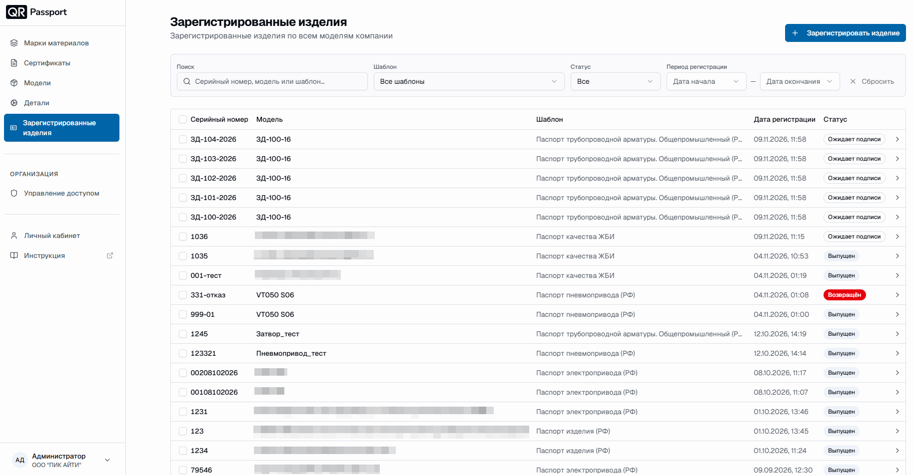

В таблице отображаются:

1. **Серийный номер** – серийный номер изделия.
2. **Модель** – модель, по которой зарегистрировано изделие.
3. **Шаблон** – шаблон паспорта изделия.
4. **Дата регистрации** – дата и время регистрации.
5. **Статус** – текущий статус изделия:
    - Ожидает подписи – паспорт создан и ожидает подписи ОТК (отдела технического контроля).
    - Выпущен – паспорт подписан ОТК и зарегистрирован.
    - Возвращён – паспорт возвращён ОТК на доработку с указанием причины возврата.

Фильтры раздела:

- **Поиск** – по серийному номеру, модели или шаблону;
- **Шаблон** – показать изделия только выбранного шаблона;
- **Период регистрации** – ограничить список датами начала и окончания;
- **Сбросить** – сброс поиска и фильтров.

Нажмите на строку изделия, чтобы открыть его карточку с паспортом и QR-кодом. Кнопка **Зарегистрировать изделие** запускает окно регистрации.

## Регистрация изделия

Регистрация выполняется в три шага: **Параметры модели** (L1), **Данные изделия** (L3) и **Шаблон и таблицы** (L2).

1. Откройте модель в разделе **Модели**.
2. Нажмите кнопку **Зарегистрировать изделие**.

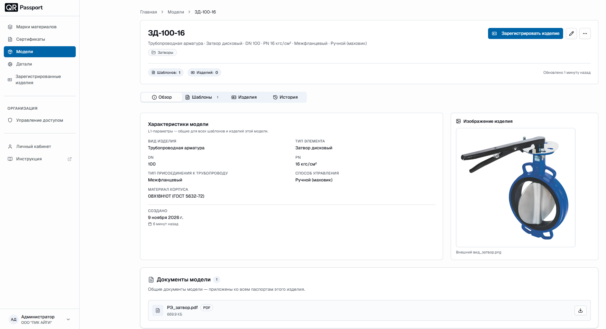

### Шаг 1. Параметры модели

Проверьте, что выбрана нужная модель. Характеристики, изображение и документы наследуются из карточки модели и на этом шаге не редактируются. Нажмите **Далее**.

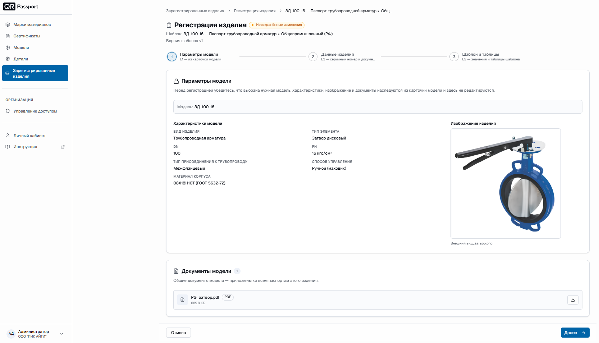

### Шаг 2. Данные изделия

Выберите режим регистрации – **Одно изделие** или **Серия изделий**.



- Одно изделие

  - **Заводской номер изделия** – система сразу проверит номер: подсказка «Серийный номер свободен» означает, что номер можно использовать;
  - **Дата изготовления (поставки)**.

  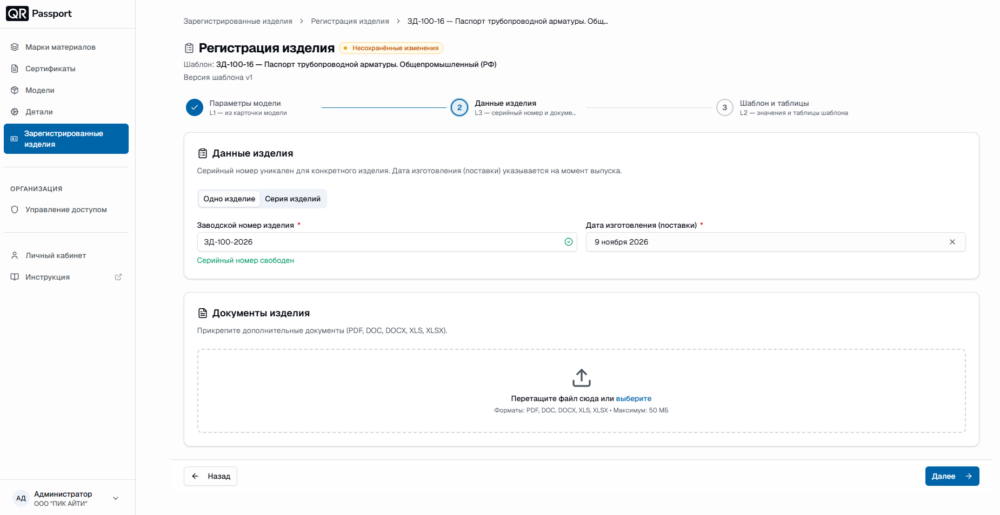

- Серия изделий

  - **Префикс** – это неизменяемое начало заводского номер (поле может быть пустым);
  - **Стартовый номер** – это начало изменяемой части заводского номера;
  - **Шаг** – шаг между номерами (по умолчанию 1);
  - **Суффикс** – это неизменяемый конец заводского номера (поле может быть пустым);
  - **Количество** – сколько изделий выпустить (максимум 250 за раз).

  

  Начните с поля «Количество» – так проще в реальном времени отслеживать, как заводские номера меняются при заполнении остальных полей.

  

  

  Система показывает сводку по номерам: заводской номер свободен или занят. 

  
  
Кликните любой номер в списке, чтобы изменить его вручную. 
**Дата изготовления (поставки)** указывается одна для всей серии.

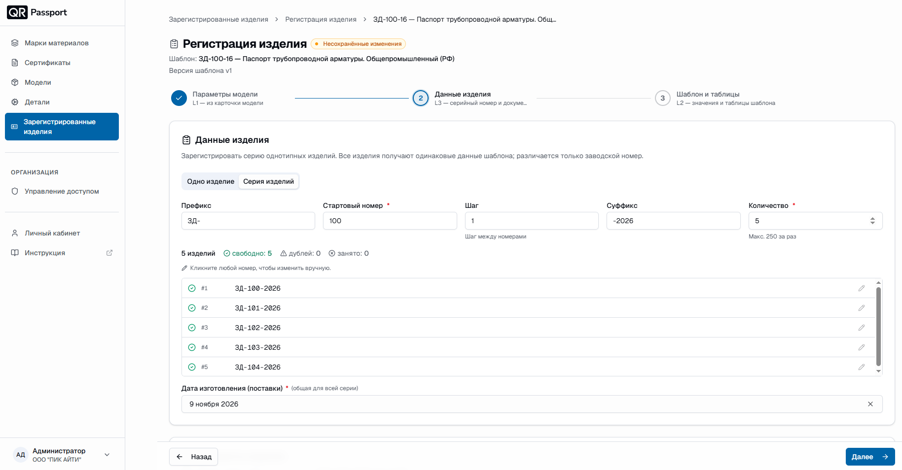



В блоке **Документы изделия** при необходимости прикрепите дополнительные документы изделия (PDF, DOC, DOCX, XLS, XLSX, до 50 МБ). Нажмите **Далее**.

### Шаг 3. Шаблон и таблицы

На этом шаге заполняются значения и таблицы шаблона – L2-данные паспорта.

Разделы шаблона раскрываются по стрелке справа. У каждого раздела видны метки: «требуется заполнить» – сколько обязательных значений не заполнено, «Без значения» – сколько необязательных полей пустые, «Изменено» – сколько значений вы изменили.

- Нажмите **Изменить**, чтобы задать значение для конкретного паспорта.
- Нажмите **Сбросить к шаблону**, чтобы вернуть значение из шаблона.

Блок **Соответствие** проверяет обязательные поля. Пока есть критичные ошибки, они перечислены списком, а кнопка регистрации неактивна с подсказкой «Исправьте ошибки соответствия перед регистрацией».

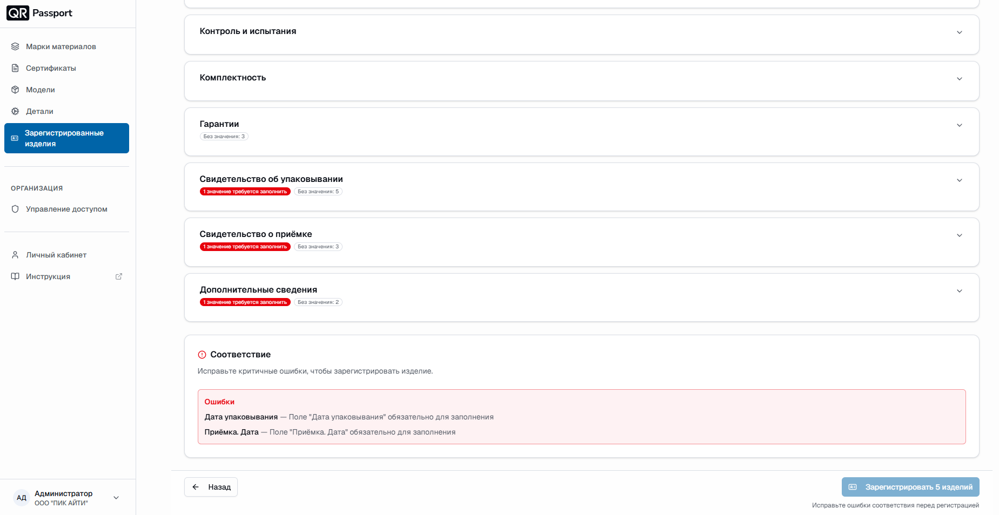

Заполните перечисленные поля (например, «Дата упаковывания», «Приёмка. Дата») – блок «Соответствие» станет зелёным: «Все обязательные поля заполнены, отклонений не обнаружено».

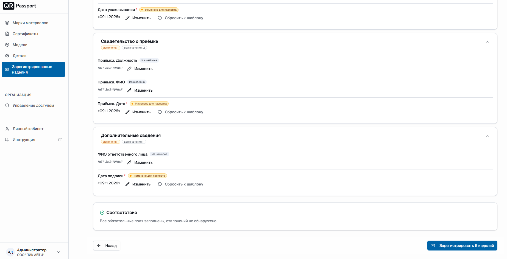

Нажмите **Зарегистрировать N изделий** для серии или **Зарегистрировать изделие** для одного изделия.

## Страница паспорта изделия в статусе «Ожидает подписи»

Нажмите на строку изделия в списке – откроется страница его паспорта. Если паспорт еще не прошел проверку ОТК, он находится в статусе «Ожидает подписи».

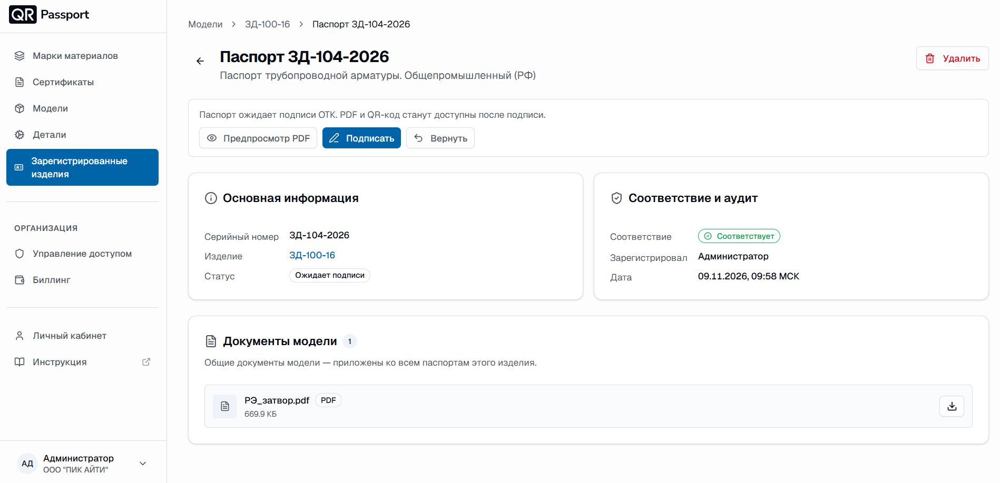

На странице отображаются:

- **Уведомление о статусе** – информационный блок с пояснением, что PDF и QR-код станут доступны только после подписи ОТК;
- **Основная информация** – серийный номер, модель (ссылка на карточку) и текущий статус изделия («Ожидает подписи»);
- **Соответствие и аудит** – результат автоматической проверки данных, пользователь, зарегистрировавший изделие, и дата регистрации;
- **Документы модели** – общие файлы, прикрепленные ко всем паспортам данной модели.

В верхней части страницы доступны действия для сотрудника ОТК:

- **Предпросмотр PDF** – просмотр содержимого паспорта перед принятием решения;
- **Подписать** – подтверждение корректности данных. После нажатия статус изделия меняется на «Выпущен», а PDF и QR-код становятся доступными для скачивания;
- **Вернуть** – отправка паспорта на доработку. Потребуется указать причину возврата, после чего статус изменится на «Возвращён».



Действия доступны только пользователям с ролью **ОТК** или другой ролью, которой разрешена подпись изделий. Подробнее о ролях см. в разделе [«Управление доступом: Роли»](https://docs.qrpassport.tech/ru/organization/access_management.html#vkladka-roli).





До момента подписи ОТК паспорт не считается выпущенным. При попытке скачать такой паспорт, будет загружен пустой ZIP-архив с пометкой **«ПРОПУЩЕН»** – это означает, что файл не был сформирован, так как паспорт еще не подписан.



### Подписание паспорта ОТК

При нажатии кнопки **Подписать** на странице паспорта появляется диалог подтверждения.

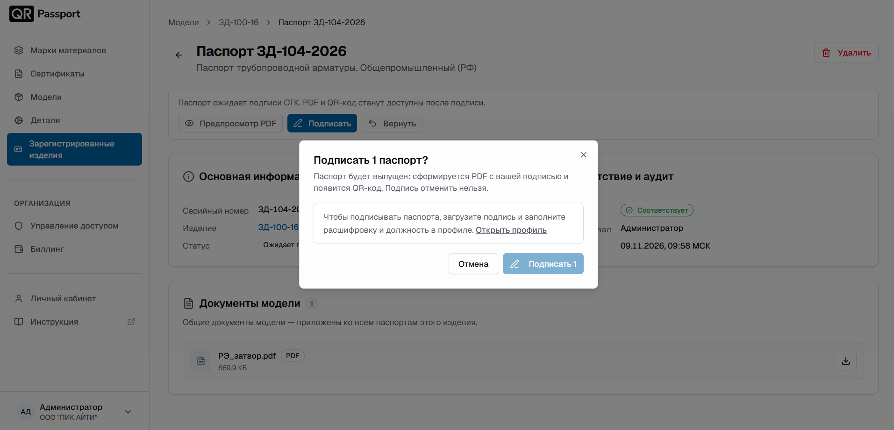



Диалог с требованием настроить подпись появляется только если подпись ещё не была добавлена в разделе «Личный кабинет». Если подпись уже настроена, паспорт можно подписать сразу.



После нажатия на ссылку **Открыть профиль** вы перейдёте на страницу настройки подписи.

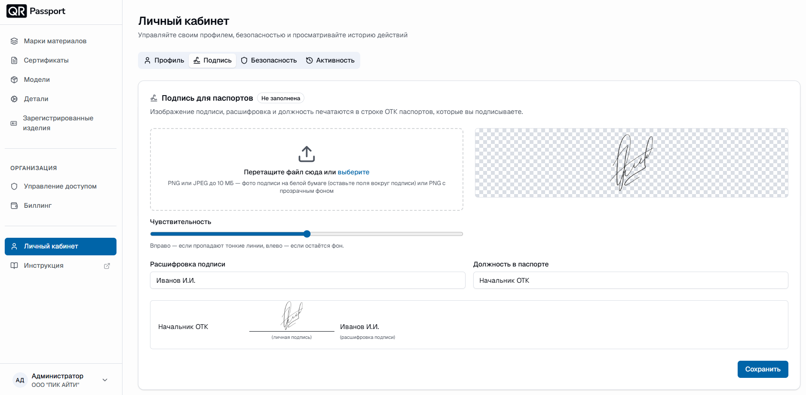

На странице **Подпись для паспортов** заполните:

1. **Изображение подписи** – загрузите файл PNG или JPEG (до 10 МБ). Рекомендуется:
   - Фото подписи на белой бумаге (оставьте поля вокруг подписи);
   - Или PNG с прозрачным фоном.
2. **Чувствительность** – ползунок для настройки качества обработки изображения:
   - Вправо – если пропадают тонкие линии;
   - Влево – если остаётся фон.
3. **Расшифровка подписи** – ФИО подписанта (например, «Иванов И.И.»);
4. **Должность в паспорте** – должность, которая будет отображаться в паспорте (например, «Начальник ОТК»).

Внизу страницы отображается превью – как будет выглядеть подпись в паспорте: должность, изображение подписи и расшифровка.

После заполнения нажмите кнопку **Сохранить**.



Подпись, расшифровка и должность печатаются в строке ОТК всех паспортов, которые вы подписываете.



## Страница зарегистрированного изделия

Нажмите на строку изделия в списке – откроется страница его паспорта.

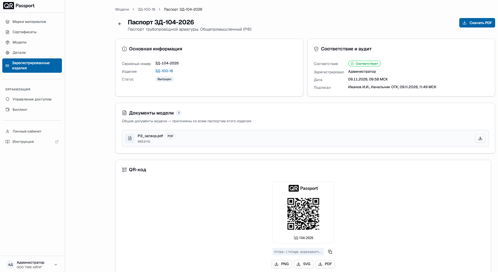

На странице отображаются:

- **Основная информация** – серийный номер, модель (ссылка на карточку) и статус изделия;
- **Соответствие и аудит** – результат проверки соответствия, кто зарегистрировал изделие, кто подписал и дата регистрации;
- **Документы модели** – общие документы, приложенные ко всем паспортам этой модели;
- **QR-код** – код изделия со ссылкой на публичную страницу, кнопкой копирования ссылки и скачиванием кода в форматах PNG, SVG или PDF.

В правом верхнем углу – кнопка **Скачать PDF** (паспорт изделия).

## Массовые действия с изделиями в списке

Отметьте изделия галочками – появится панель «N выбрано» с кнопкой **Очистить** и действиями над выбранными.

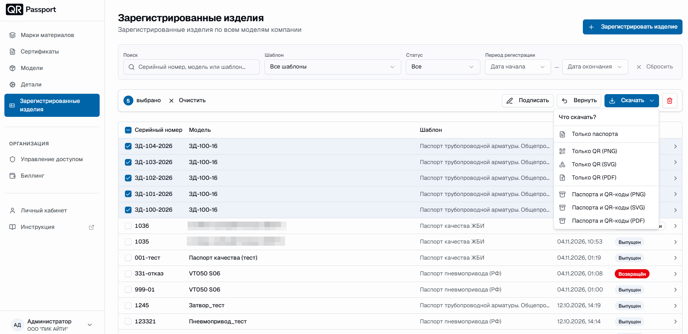

- **Подписать** – массовая подпись однотипных паспортов. После подтверждения все выбранные изделия, находящиеся в статусе «Ожидает подписи», переходят в статус «Выпущен»: формируется PDF с вашей подписью и появляется QR-код.

- **Вернуть** – массовый возврат однотипных паспортов на доработку. После подтверждения все выбранные изделия, находящиеся в статусе «Ожидает подписи», переходят в статус «Возвращён». Потребуется указать причину возврата – она будет отображаться в карточке каждого возвращённого паспорта.



Массовый возврат необратим в рамках одной операции – для повторной отправки на подпись потребуется исправить ошибки и заново зарегистрировать изделия.



- **Скачать** – меню вариантов загрузки:
  - только паспорта;
  - только QR-коды (PNG, SVG или PDF);
  - паспорта и QR-коды вместе (PNG, SVG или PDF).



По умолчанию паспорта скачиваются в формате PDF.



- **Удалить** – изделие удаляют, если оно создано по ошибке или больше не нужно.



Удаление изделий необратимо – восстановить их после подтверждения будет нельзя. Поэтому требуется ввести слово **«Удалить»**: это защита от случайного нажатия кнопки.



## Публичная страница по QR-коду

Отсканируйте QR-код изделия – откроется публичная страница паспорта, доступная без входа в систему. На ней видны статус «Паспорт действителен», модель, серийный номер, дата регистрации, изображение изделия, кнопка «Открыть паспорт» и документы модели. Именно эту страницу видит ваш клиент после сканирования QR-кода на корпусе.

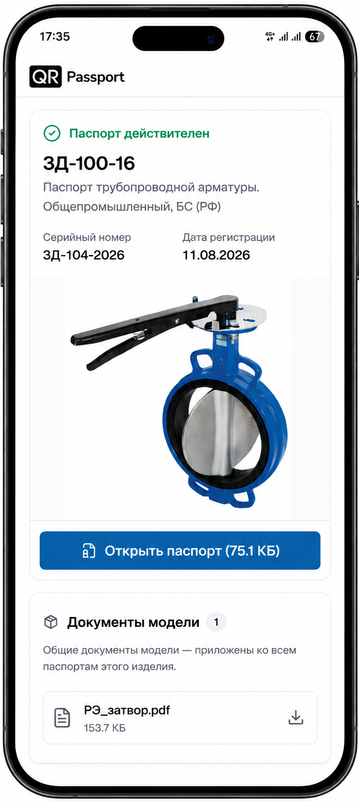

## Результат

Зарегистрированные изделия появляются в списке раздела со статусом «Выпущен». Из карточки изделия можно скачать паспорт и QR-код, а при необходимости – удалить изделие, отметив его галочкой в списке.

